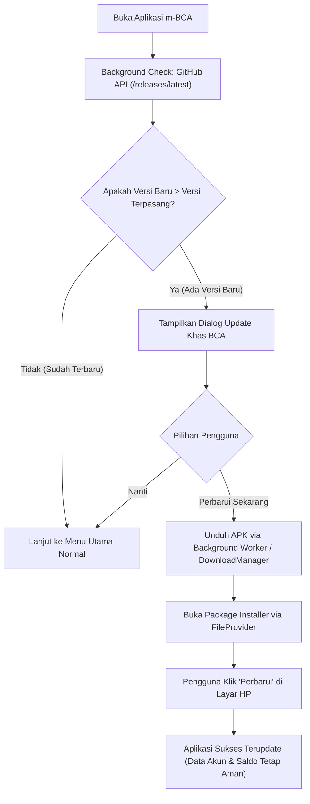

# Task Breakdown: Sistem Auto-Update via GitHub Releases

Dokumen ini memuat rencana kerja, tahapan eksekusi, arsitektur teknis, dan panduan operasional untuk implementasi **Sistem Auto-Update Over-The-Air (OTA) via GitHub Releases** pada aplikasi **BCA Mobile Android Native**, sehingga aplikasi dapat dibagikan ke HP lain dan otomatis memperbarui dirinya sendiri tanpa perlu kabel USB/PC.

---

## 1. Status Konektivitas GitHub
- **Status Akun**: Terhubung & Terautentikasi (Valid)
- **Akun GitHub**: `rezzboyy`
- **Metode CLI**: GitHub CLI (`gh`) via OAuth Keyring
- **Target Repositori**: `rezzboyy/bca-mobile-android`

---

## 2. Diagram Alur Sistem Auto-Update

---

## 3. Rincian Fase & Daftar Tugas (Task List)

### Fase 1: Fondasi Keystore Permanen & Keamanan Tanda Tangan
- [ ] **Task 1.1: Pembuatan Keystore Rilis Permanen**
  - Buat keystore `bca_release.jks` dengan masa berlaku 25+ tahun.
  - Simpan di folder aman `app/keystore/bca_release.jks`.
- [ ] **Task 1.2: Konfigurasi `signingConfigs` di `app/build.gradle.kts`**
  - Daftarkan `release` dan `debug` signing config agar menggunakan keystore yang sama.
  - *Tujuan*: Menjamin HP lain tidak akan pernah mengalami error *"Aplikasi tidak terpasang karena paket bertentangan"*.
- [ ] **Task 1.3: Konfigurasi Versioning Otomatis**
  - Pastikan `versionCode` dan `versionName` siap dinaikkan setiap kali rilis baru dibuat.

---

### Fase 2: Konfigurasi Izin Sistem & FileProvider Android
- [ ] **Task 2.1: Tambah Izin Android pada `AndroidManifest.xml`**
  - Tambahkan `<uses-permission android:name="android.permission.INTERNET" />`
  - Tambahkan `<uses-permission android:name="android.permission.REQUEST_INSTALL_PACKAGES" />`
- [ ] **Task 2.2: Setup `FileProvider` untuk Instalasi APK**
  - Buat resource file paths `app/src/main/res/xml/file_paths.xml` (mengizinkan akses direktori `cache-path` dan `external-cache-path`).
  - Daftarkan `<provider>` di `AndroidManifest.xml` dengan otoritas `${applicationId}.provider`.

---

### Fase 3: Modul Pengecek & Pengunduh Update (`GitHubUpdateManager`)
- [ ] **Task 3.1: Buat Model Data Update**
  - Model `GitHubRelease` (`tagName`, `name`, `body`, `apkDownloadUrl`, `publishedAt`).
- [ ] **Task 3.2: Implementasi `GitHubUpdateService`**
  - Fungsi `checkForUpdate()`: memanggil endpoint publik `https://api.github.com/repos/rezzboyy/bca-mobile-android/releases/latest`.
  - Fungsi parsing versi: membandingkan tag (misal `v1.0.1` atau versionCode) dengan versi lokal yang sedang berjalan.
- [ ] **Task 3.3: Implementasi Download & Install Trigger**
  - Download file `.apk` ke penyimpanan cache aplikasi dengan pelacakan progres (0% - 100%).
  - Panggil Intent `android.intent.action.VIEW` dengan `FLAG_GRANT_READ_URI_PERMISSION` dan MIME `application/vnd.android.package-archive` untuk memicu layar installer Android.

---

### Fase 4: Desain UI Dialog Update Bertema BCA
- [ ] **Task 4.1: Dialog Konfirmasi Pembaruan**
  - Menggunakan bahasa visual resmi BCA (Header biru, tombol gradien 3D, info versi & changelog).
  - Tombol aksi: **"Perbarui Sekarang"** dan **"Nanti"**.
- [ ] **Task 4.2: Dialog Progres Unduhan**
  - Progress bar melingkar/linear elegan dengan indikator persentase unduhan ("Mengunduh pembaruan... 65%").
- [ ] **Task 4.3: Integrasi ke `MainActivity.kt`**
  - Pengecekan otomatis di latar belakang saat aplikasi baru pertama kali dibuka (*cold start*).

---

### Fase 5: Setup Repositori GitHub & Skrip Rilis 1-Klik
- [ ] **Task 5.1: Inisialisasi Repositori GitHub**
  - Buat repositori `rezzboyy/bca-mobile-android` via GitHub CLI (`gh repo create`).
  - Push commit codebase awal ke GitHub.
- [ ] **Task 5.2: Buat Skrip Otomatisasi Rilis (`release.ps1`)**
  - Skrip PowerShell untuk:
    1. Membaca/menaikkan versi (`versionCode` & `versionName`).
    2. Build release APK (`./gradlew assembleRelease`).
    3. Membuat GitHub Release baru dan mengunggah APK via CLI (`gh release create vX.X.X app-release.apk --notes "..."`).

---

### Fase 6: Pengujian & Validasi End-to-End
- [ ] **Task 6.1: Uji Coba Pengecekan Versi Sama (No Update)**
  - Pastikan app tidak memunculkan popup jika versi sudah terbaru.
- [ ] **Task 6.2: Uji Coba Rilis Versi Baru (Live OTA Update)**
  - Publikasikan rilis baru v1.0.1 ke GitHub.
  - Buka app di HP fisik Samsung (`eee39b64`).
  - Verifikasi dialog update muncul -> klik download -> instalasi berhasil tanpa kendala.
